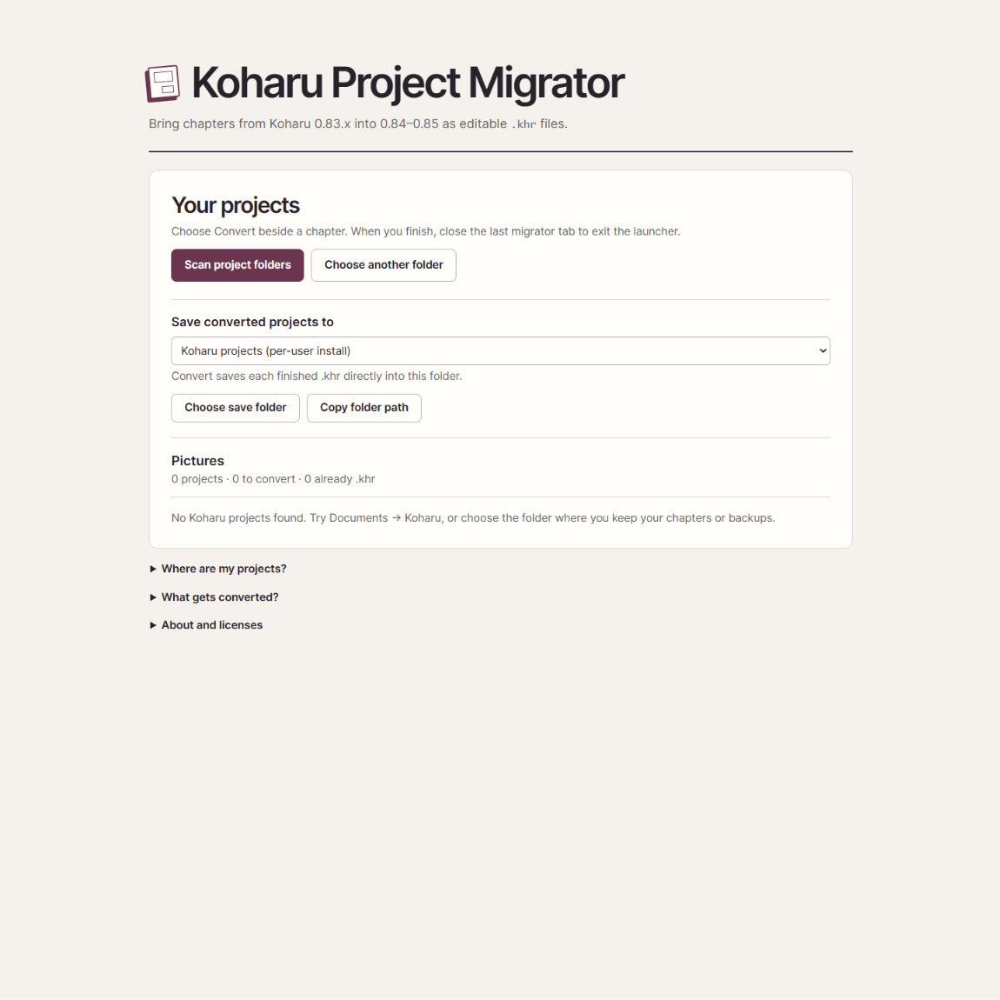

# Koharu Project Migrator

Convert a Koharu 0.83.x chapter folder into an editable `.khr` project for Koharu 0.84 or 0.85. For example, the migrator reads `Chapter 01.khrproj` and saves a separate file named `Chapter 01 (migrated).khr`. It carries over scans, page order, text, translations, groups, and paint layers. Text can wrap differently in the newer editor.

## Downloads

| Edition | Download | How to open it |
| --- | --- | --- |
| Browser | [Standalone HTML file](https://github.com/roorem10/koharu-project-migrator/releases/download/v1.0.0/Koharu-Project-Migrator.html) | Open the downloaded file in desktop Edge or Chrome. It runs locally. |
| Windows x64 | [Portable Windows ZIP](https://github.com/roorem10/koharu-project-migrator/releases/download/v1.0.0/Koharu-Project-Migrator-v1.0.0-windows-x64.zip) | Right-click the ZIP, choose **Extract All**, then open **Start Koharu Migrator.exe**. |

Checksums and the Windows build log are on the [v1.0.0 release page](https://github.com/roorem10/koharu-project-migrator/releases/tag/v1.0.0).



## Use it in your browser

1. Open the downloaded `Koharu-Project-Migrator.html` in desktop Edge or Chrome.
2. Close the chapter in the old Koharu. Click **Scan Documents** and choose the folder containing your chapters, or select one `.khrproj` folder.
3. Click **Convert** next to the chapter. Choose the newer Koharu installation’s `projects` folder when prompted. For a manual save, choose **Download manually** before converting, then click **Download .khr** and move the file into `projects`. On Windows the usual location is `%LOCALAPPDATA%\Koharu\projects`.
4. Open or reopen the newer Koharu and select the chapter ending in **(migrated)**.

## How the Windows launcher works

The optional 64-bit Windows launcher embeds the same page. It opens your default browser and listens on `127.0.0.1` on a port chosen at startup. It looks for projects in Documents, OneDrive Documents, and known Koharu locations. For custom installations, it checks the path of a running `koharu.exe`. Conversion takes place on your computer. Closing the last migrator tab lets the launcher exit.

To check a downloaded launcher before opening it, run this command in PowerShell from its folder and compare the result with the SHA-256 listed below.

```powershell
Get-FileHash -Algorithm SHA256 -LiteralPath '.\Start Koharu Migrator.exe' | Format-List Hash
```

## Read the source

| Path | What to look for |
| --- | --- |
| [src/legacy.mjs](src/legacy.mjs) | Reads legacy save revisions and checks the hashes of referenced files. |
| [src/migrate.mjs](src/migrate.mjs) and [src/pixels.mjs](src/pixels.mjs) | Write the SQLite project, convert image layers and masks, and check the finished database. |
| [src/](src/) | Also contains the browser interface, folder discovery, conversion controls, and destination handling. |
| [desktop/](desktop/) | Go launcher, local server, Windows folder detection, file saving, and launcher tests. |
| [build.mjs](build.mjs) and [vendor/](vendor/) | The offline build script and its bundled dependencies, including the SQLite WebAssembly engine. |

Third-party credits and license text are included in [THIRD-PARTY-NOTICES.txt](THIRD-PARTY-NOTICES.txt).

## Build and verify

The release was built with **Node.js 24.22.3** and **Go 1.27.4**. Use these versions to reproduce the hashes below. The browser build only needs Node.js. All build inputs are included.

From the repository root, rebuild the browser edition. This also generates `desktop/ui.html` for the Go launcher.

```sh
node build.mjs
```

With Go installed, run the launcher tests from the same directory.

```sh
go -C desktop test .
```

To build the Windows x64 launcher in PowerShell, run the following from the repository root.

```powershell
$env:CGO_ENABLED = "0"
$env:GOOS = "windows"
$env:GOARCH = "amd64"
$env:GOAMD64 = "v1"
go -C desktop build -buildvcs=false -trimpath -ldflags="-s -w -H=windowsgui" -o "../release/Start Koharu Migrator.exe" .
```

On Linux or macOS, this command builds the same Windows target.

```sh
CGO_ENABLED=0 GOOS=windows GOARCH=amd64 GOAMD64=v1 \
  go -C desktop build -buildvcs=false -trimpath -ldflags="-s -w -H=windowsgui" -o "../release/Start Koharu Migrator.exe" .
```

Both files rebuilt from this source matched the original distribution byte for byte. To compare your own rebuild, run this command from the repository root.

```powershell
Get-FileHash -Algorithm SHA256 -Path '.\release\Koharu-Project-Migrator.html', '.\release\Start Koharu Migrator.exe' | Format-List Path, Hash
```

| File | SHA-256 of the original release |
| --- | --- |
| `Koharu-Project-Migrator.html` | `5a7e791ed9bb26a9cadeaca4a6a0342d312d9da434083734f40bdc93f3d2a4ae` |
| `Start Koharu Migrator.exe` | `7a56f260af8ef0fb413f3e228e1a01e43d862d064e0674fc7e9bd58bd10d4dda` |

Koharu Project Migrator is an independent utility.
